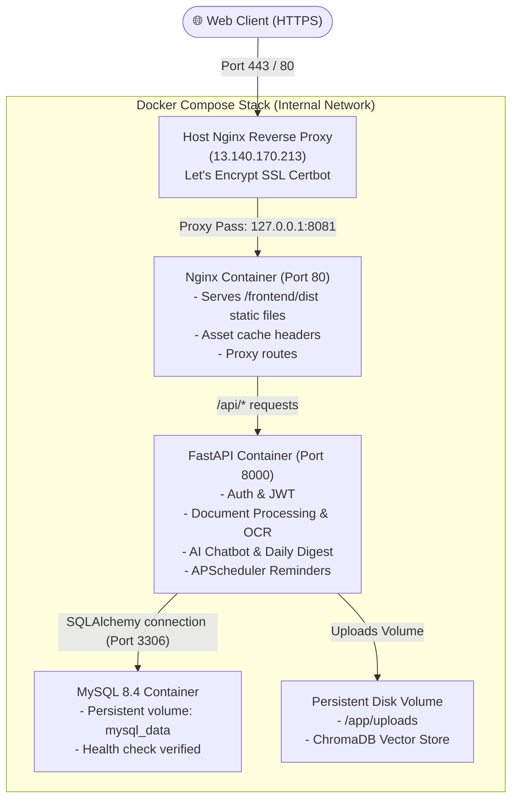

# BookKeepPro — Comprehensive Production Deployment Guide

**Target Domain:** [`https://aicpa.duckdns.org`](https://aicpa.duckdns.org)  
**Target VPS Server:** `Contabo VPS (13.140.170.213)`  
**Stack:** React 19 (Vite) + FastAPI (Python 3.12) + MySQL 8.4 + Docker Compose + Host Nginx (Certbot SSL)

---

## 1. System Architecture



---

## 2. Pre-Deployment: Local Workstation Preparation

Perform these steps inside your local project folder (`Bookkeep`):

### Step 2.1 — Fresh Frontend Production Build
Compile and bundle all JSX components, CSS tokens, and assets into production-ready static files:

```powershell
cd frontend
npm run build
cd ..
```
*Expected Output:*
```text
dist/index.html                   1.05 kB
dist/assets/index-Q3NiwG1z.css   44.73 kB
dist/assets/index-DYQgi1rI.js   418.74 kB
✓ built in 1.5s
```

### Step 2.2 — Validate Environment Schema
Ensure no placeholder passwords or missing keys exist:
```powershell
python services/api/validate_env.py
```
*Expected Output:* `Environment validation passed.`

### Step 2.3 — Commit and Push to Git
Commit all validated changes, tests, and updated build files:
```powershell
git add .
git commit -m "feat: complete platform overhaul, bugfixes, and verified production release"
git push origin main
```

---

## 3. VPS Initial Setup & Prerequisites (One-Time)

Log in to your Contabo VPS via SSH:
```bash
ssh root@13.140.170.213
```

### Step 3.1 — Install System Packages & Docker
If not already installed on the VPS:
```bash
sudo apt-get update && sudo apt-get upgrade -y
sudo apt-get install -y curl git ufw nginx certbot python3-certbot-nginx

# Install Docker & Compose plugin
curl -fsSL https://get.docker.com -o get-docker.sh
sh get-docker.sh
sudo systemctl enable --now docker
```

### Step 3.2 — Configure Firewall (UFW)
Ensure HTTP, HTTPS, and SSH ports are open:
```bash
sudo ufw allow 22/tcp
sudo ufw allow 80/tcp
sudo ufw allow 443/tcp
sudo ufw --force enable
sudo ufw status
```

---

## 4. VPS Host Nginx & Let's Encrypt SSL Configuration

The Host Nginx handles public incoming connections on ports 80/443, terminates SSL, and forwards traffic to the Docker Nginx container running on `127.0.0.1:8081`.

### Step 4.1 — Create Host Nginx Configuration
Create or edit `/etc/nginx/sites-available/aicpa.duckdns.org`:

```bash
sudo nano /etc/nginx/sites-available/aicpa.duckdns.org
```

Paste the following configuration:

```nginx
server {
    listen 80;
    server_name aicpa.duckdns.org 13.140.170.213;

    client_max_body_size 25M;

    location / {
        proxy_pass http://127.0.0.1:8081;
        proxy_http_version 1.1;
        proxy_set_header Upgrade $http_upgrade;
        proxy_set_header Connection "upgrade";
        proxy_set_header Host $host;
        proxy_set_header X-Real-IP $remote_addr;
        proxy_set_header X-Forwarded-For $proxy_add_x_forwarded_for;
        proxy_set_header X-Forwarded-Proto $scheme;
        proxy_read_timeout 120s;
        proxy_send_timeout 120s;
    }
}
```

### Step 4.2 — Enable Site and Test Syntax
```bash
sudo ln -sf /etc/nginx/sites-available/aicpa.duckdns.org /etc/nginx/sites-enabled/
sudo rm -f /etc/nginx/sites-enabled/default
sudo nginx -t
sudo systemctl reload nginx
```

### Step 4.3 — Obtain Free Let's Encrypt SSL Certificate
Run Certbot to automatically configure HTTPS:
```bash
sudo certbot --nginx -d aicpa.duckdns.org
```
When prompted:
1. Enter your contact email.
2. Agree to terms (`Y`).
3. Certbot will test the challenge, install SSL certificates, and configure HTTPS automatic redirection.

Verify auto-renewal:
```bash
sudo certbot renew --dry-run
```

---

## 5. Application Deployment via Docker Compose

### Step 5.1 — Pull the Code on VPS
```bash
cd /var/www/Bookkeep   # or your deployment directory on the VPS
git pull origin main
```

### Step 5.2 — Verify the Production `.env` File
Ensure `/var/www/Bookkeep/.env` exists and matches the production settings:

```ini
# DATABASE
MYSQL_HOST=db
MYSQL_PORT=3306
MYSQL_USER=root
MYSQL_PASSWORD=your_secure_db_password
MYSQL_DATABASE=bookkeepprodb

# SECURITY
SECRET_KEY=your_generated_secret_key_here
JWT_ALGORITHM=HS256
ACCESS_TOKEN_EXPIRE_MINUTES=480

# SERVER SETTINGS
FRONTEND_URL=https://aicpa.duckdns.org
ALLOWED_ORIGINS=https://aicpa.duckdns.org

# EMAIL (Gmail SMTP)
ADMIN_EMAIL=atharvg.aiindia@gmail.com
MAIL_FROM=atharvagunjarge5@gmail.com
MAIL_FROM_NAME=AiIndia_CPA
SMTP_HOST=smtp.gmail.com
SMTP_PORT=587
SMTP_USER=atharvagunjarge5@gmail.com
SMTP_PASSWORD=your_smtp_app_password_here
SMTP_TLS=True
MAIL_SSL_TLS=False

# OPENROUTER (Chatbot + OCR Models)
OPENROUTER_API_KEY="your_openrouter_api_key_here"
OCR_TEXT_MODEL=meta-llama/llama-3.3-70b-instruct
OCR_VISION_MODEL=qwen/qwen2.5-vl-72b-instruct
OCR_FALLBACK_MODEL=google/gemma-3-27b-it
TESSERACT_LANG=eng+hin
CHAT_MODEL=meta-llama/llama-3.3-70b-instruct
```

> [!IMPORTANT]
> Within the Docker Compose network, `MYSQL_HOST` must be set to `db` so FastAPI connects to the MySQL container.

### Step 5.3 — Build & Launch Containers
```bash
# Clean previous containers
docker compose down

# Build backend and launch all 3 services in detached mode
docker compose build --no-cache app
docker compose up -d
```

### Step 5.4 — Verify Container Health
Run:
```bash
docker compose ps
```
All services must show healthy and running:
```text
NAME                 IMAGE               STATUS                    PORTS
bookkeep-app-1       bookkeep-app        Up (healthy)              8000/tcp
bookkeep-db-1        mysql:8.4           Up (healthy)              3306/tcp, 33060/tcp
bookkeep-nginx-1     nginx:1.25-alpine   Up                        127.0.0.1:8081->80/tcp
```

Check the migration output in the backend logs:
```bash
docker compose logs app | tail -n 35
```
You should see:
- `[entrypoint] Running DB migrations...`
- `All migrations complete.`
- `Environment validation passed.`
- `Application startup complete.`
- `Uvicorn running on http://0.0.0.0:8000`

---

## 6. Post-Deployment Smoke Tests

Execute these verification checks from your browser and terminal:

| Test # | Check Item | Test Action | Expected Result |
| :---: | :--- | :--- | :--- |
| **1** | **SSL / HTTPS** | Navigate to `https://aicpa.duckdns.org` | Valid green padlock; redirects HTTP to HTTPS automatically |
| **2** | **Health Endpoint** | `curl -i https://aicpa.duckdns.org/health` | `HTTP/1.1 200 OK` with body `{"status":"ok"}` |
| **3** | **API 404 Guard** | `curl -i https://aicpa.duckdns.org/api/invalid-test` | `404 Not Found` in JSON format (not HTML) |
| **4** | **Client Sign In** | Log in with a client account | Successfully loads User Dashboard with Engagement Letter card |
| **5** | **Deadlines Banner** | Check User Dashboard | If deadlines are within 7 days, warning alert displays |
| **6** | **Document Upload** | Upload sample W-2 or 1099 in Personal Upload | Upload completes, OCR extraction kicks off, document appears in table |
| **7** | **Admin Dashboard** | Log in as Admin (`atharvg.aiindia@gmail.com`) | Shows 14 users, pending count, Daily Digest HTML block |
| **8** | **Approved Return Lock** | Try deleting an approved return in Admin User Detail | Delete button is locked / backend responds with 400 |
| **9** | **Client Review** | Admin sends return for approval; Client reviews | Client sees Approve and Reject buttons; status updates in real-time |
| **10** | **Admin Chatbot** | Open floating chatbot on Admin Dashboard | AI replies with firm statistics and handles bulk action requests |

---

## 7. Operational Maintenance Commands

### Fast Code Update (Subsequent Releases)
```bash
cd /var/www/Bookkeep
git pull origin main
cd frontend && npm run build && cd ..
docker compose restart nginx
docker compose up -d --build app
```

### Live Log Streaming
```bash
# View backend application logs
docker compose logs -f --tail=50 app

# View web server access & error logs
docker compose logs -f --tail=50 nginx
```

### Database Backup
```bash
docker exec $(docker compose ps -q db) mysqldump -uroot -p"$MYSQL_PASSWORD" bookkeepprodb > backup_$(date +%F_%T).sql
```
